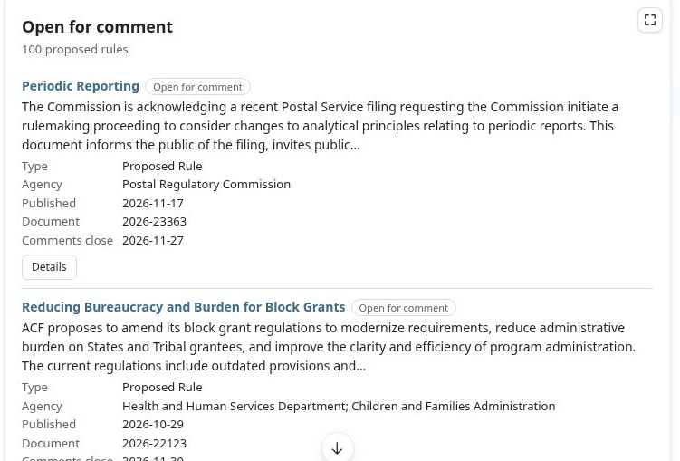

# Federal Rules Watch

See what an agency published, what is still a proposal, and when comments close. Federal Rules Watch links each finding to its Federal Register record and keeps publication, effective, and deadline dates distinct.

[Connect with Claude, ChatGPT, Muse Code, or Grok](PROVIDERS.md)

## Try it

- Which proposed federal rules about offshore wind are open for comment? Include deadlines and official links.
- Compare the most recent FAA final and proposed rules involving drones and identify their document numbers.
- What is Federal Register document 2026-22617, and when do comments close?
- Give me a digest of everything the EPA and the FDA published since the first of the month.

## Install in Claude

In Claude Code, run the following commands.

```text
/plugin marketplace add OpZero-sh/plugins
/plugin install federal-rules-watch@opzero
```

In Claude chat or Cowork, open the installed plugin’s **Connectors** tab and connect the listed service. The hosted service uses public data and needs no sign in. Then ask a question or name one of the skills below.

## What is included

### Skills

| Skill | What it does |
| --- | --- |
| `regulatory-brief` | Searches the Federal Register by topic, agency, document type and date, screens out loose matches, and briefs you on each document with its type, dates, document number and link. |
| `comment-deadlines` | Lists proposed rules that are open for public comment, confirms each closing date against the full record, checks for extensions, and gives the official comment link. |
| `read-federal-document` | Takes one document number or federalregister.gov link and explains what the document is, who issued it, what each date means and where the full text is. |

Each skill carries reference files that Claude reads when needed: the legal meaning of each document type, how the search behaves and which agency slugs are confirmed, how comment periods and extensions work, a glossary of record fields and identifiers, and answer templates.

### Agents

| Agent | When Claude delegates to it |
| --- | --- |
| `docket-researcher` | Tracing one rulemaking across its proposal, extensions, corrections and final rule, with a dated chronology and the basis for linking each document. |
| `watchlist-digest` | Building a roundup of new documents since a date across several topics or agencies. |

Both agents are limited to the three read only lookup tools of the connector.

### Hook

One `PostToolUse` hook runs in Claude Code after any of the three lookup tools returns. It is the script `hooks/comment-deadlines.cjs`. When the result lists a comment deadline, the hook counts the days left from today's date on your computer and hands Claude that figure with the document number, so an answer such as "closes in 3 days" comes from a calculation. It needs Node.js on your PATH, reads the tool result from standard input, and does not touch files or the network. It never interrupts a tool call.

## What the plugin connects to

- **One hosted MCP server**, `register`, at `https://federal-rules-watch.mcp.opzero.sh/mcp`. It needs no sign in. Each tool call sends the search words, filters or document number in your request to that server, which looks them up in the public Federal Register API and returns the records. The server states that requests are not stored. Its tools are `search_federal_documents`, `open_comment_periods` and `get_federal_document`, all read only.
- **Links in answers.** Answers cite pages on federalregister.gov and comment pages on regulations.gov for you to open. The plugin does not fetch those pages and never submits a comment.

## Optional files for other clients

These files are not used by Claude. Nothing in them runs unless you run it yourself.

- `integrations/grok_example.py` is a sample script for the xAI API. When you run it without the dry run flag, it reads `XAI_API_KEY` from your environment, and `XAI_MODEL` if set, and sends your question with the server address and tool list to `https://api.x.ai/v1/responses`. With `--dry-run` it prints the request and sends nothing.
- `integrations/grok-servers.json` holds the server address and tool list that script uses.
- `integrations/openai/` holds the manifest and connection file for the ChatGPT and Codex package.
- `scripts/build_openai.py` builds that package as a ZIP on your machine from the manifests, the skills, the license and the product icon. It makes no network requests.
- `.muse-plugin/plugin.json` is the manifest for Muse Code.

## Sources and coverage

Coverage is the US Federal Register: rules, proposed rules, notices and presidential documents. The connector returns document metadata and the agency's summary when one exists. It does not return the regulatory text, docket contents or CFR citations. Each record links to FederalRegister.gov, where the document page links to the official edition and to any Regulations.gov comment page.

A record shows a document as published. It does not show whether a rule was later delayed, amended, withdrawn or overturned. Comment closing dates are dates only, and the document itself sets the cutoff time and the accepted ways to comment. State and local rules are not covered.

This plugin provides public information. It is not legal advice. For a decision that depends on a rule, read the official document or ask the agency contact it names.

- [federal-rules-watch](https://federal-rules-watch.mcp.opzero.sh/) · [Privacy](https://federal-rules-watch.mcp.opzero.sh/?page=privacy) · [Support](https://federal-rules-watch.mcp.opzero.sh/?page=support)

## In use

Examples from the connected services in Claude.


